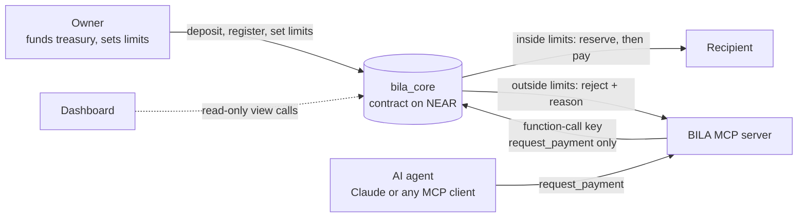

<p align="center"></p>

# BILA

**Your agents. Your money. Your rules.**

BILA is a spending-limit layer for AI agents, built on NEAR. An owner funds a restricted treasury, registers an agent, and sets limits. The agent can only *ask* to spend. A smart contract (`bila_core`) approves or blocks every request, on chain, independently of the AI model, the MCP server, or any database.

> Status: live on **NEAR testnet**. A working prototype built for a hackathon, not a finished product. See [What is and isn't verified](#what-is-and-isnt-verified).

## Quick links

| | |
|---|---|
| Live dashboard | https://bila-psi.vercel.app |
| Gift Platform demo | https://bila-psi.vercel.app/gift |
| Contract (testnet) | [`bila-treasury-01.testnet`](https://testnet.nearblocks.io/address/bila-treasury-01.testnet) |
| MCP endpoint (agent tools) | see [Connect an AI to BILA](#connect-an-ai-to-bila) |
| Architecture | [docs/ARCHITECTURE.md](docs/ARCHITECTURE.md) |
| Status and limits | [docs/STATUS.md](docs/STATUS.md) |

## The problem

AI agents are starting to handle money, and today there are two options. Give the agent the keys, and one bad prompt or one bug can empty the wallet. Or approve every payment yourself, and then the agent is not really autonomous. Agents need a spending limit they cannot talk their way around.

## How it works



1. **Owner funds a treasury** and registers an agent with four limits: per payment, per day, per week, per month. Recipients can be restricted to a list, or left open.
2. **The agent asks BILA to pay someone** (`request_payment`).
3. **The contract checks the rules.** Inside the limits, the amount is reserved and paid. Outside them, the request is rejected with a plain reason and nothing moves.

### What the contract enforces

| Rule | Enforced by |
|---|---|
| Only a registered, active agent can spend (caller == agent account) | contract |
| Per-transaction, daily, weekly, monthly limits (UTC; week = Mon to Sun) | contract |
| Amount reserved against every limit at request time (no concurrent overspend) | contract |
| Optional recipient allowlist; never to the agent itself or the contract | contract |
| Owner withdraws only unreserved funds | contract |
| Loosening (register, set policy, resume, withdraw) needs a full-access key (1 yoctoNEAR) | contract |
| Pause / revoke work without a deposit (emergency switch) | contract |
| Same `request_id` never pays twice | contract |
| Failed transfer releases its reservation; unconfirmed one expires conservatively | contract |

All amounts are integer yoctoNEAR. Limits are denominated in **NEAR** (no price oracle in this MVP).

### Who can do what

| Actor | Can | Cannot |
|---|---|---|
| Owner | fund the treasury, register agents, set limits, pause or revoke, withdraw unreserved funds | spend an agent's reserved funds |
| Agent (via MCP) | ask for a payment, check its own budget and history | change its limits, attach deposits, move funds directly |
| MCP server | relay agent requests with a key limited to `request_payment` | loosen limits, withdraw, impersonate another agent |
| Dashboard | read | write |

## Connect an AI to BILA

BILA exposes an **MCP server** (Streamable HTTP, no OAuth). Any MCP-capable client can use it. The hosted endpoint serves the **agent role only**: owner actions never go through it.

**MCP URL (testnet demo agent):**

```
https://bila-psi.vercel.app/api/mcp?k=bila_ag_frmjnZppQ0L9buwdZFDfyt3puV_uELoxpCzaAi3jNzA
```

The `k=` value is a bearer token for the demo agent. Treat the full link like a password. It only ever acts as that one agent, inside the agent's limits, on testnet, and it will be rotated after the hackathon judging. The server stores only a hash of the token.

### Tools the agent gets

| Tool | What it does |
|---|---|
| `get_agent_status` | The agent's status, limits and remaining budget |
| `check_budget` | Dry run: would this payment (recipient, amount) be allowed right now? |
| `request_payment` | Ask BILA to pay: `request_id`, `recipient`, `amount_near`, optional `memo`. Reuse the same `request_id` when retrying |
| `get_transaction_history` | Recent payments, with `limit` (1 to 50) |

### Claude (claude.ai or Claude Desktop)

1. Open **Settings**, then **Connectors**.
2. Click **Add custom connector**.
3. Name it `BILA` and paste the MCP URL above. No sign-in is needed.
4. Add it, then enable the connector in a chat.
5. Try:
   - `Check my BILA budget.`
   - `Pay 0.2 NEAR to <testnet account>, memo "gift". Use a new request id.`
   - `Pay 5 NEAR to <testnet account>.` (should be blocked)

Custom connectors depend on your Claude plan.

### Claude Code

```bash
claude mcp add --transport http bila "https://bila-psi.vercel.app/api/mcp?k=<token>"
```

### ChatGPT

In developer mode, add a server with the MCP URL and authentication set to none. Availability depends on the plan. Not tested here.

### Any other MCP client (Cursor, Windsurf, custom agents)

Point the client at the URL as a remote or Streamable HTTP server. In clients that use a JSON config:

```json
{
  "mcpServers": {
    "bila": { "url": "https://bila-psi.vercel.app/api/mcp?k=<token>" }
  }
}
```

If the client lets you set headers, you can send the token as `Authorization: Bearer <token>` instead of using `?k=`.

### Test it without an AI client

```bash
curl -s -X POST "https://bila-psi.vercel.app/api/mcp?k=<token>" \
  -H 'content-type: application/json' \
  -H 'accept: application/json, text/event-stream' \
  -d '{"jsonrpc":"2.0","id":1,"method":"tools/list"}'
```

A missing or wrong token returns `401`.

### Current demo limits

Per payment 2 NEAR, per day 5, per week 8, per month 10. Recipients: any account except the agent itself and the contract. The treasury holds testnet NEAR only, so please keep requests small. Payments above a limit are blocked on purpose, which is the point of the demo.

## Gift Platform demo

Open https://bila-psi.vercel.app/gift and press **Start requests**. A mock gifting platform sends payment requests to BILA on its own, with random amounts and timing. Requests inside the agent's limits are approved and settle on chain. Requests above the per-payment cap, or after the daily budget is used, are blocked with a reason. The dashboard on the right reads live from the contract. It stops by itself after the number of requests you set (default 20).

## Owner actions (CLI)

Owner actions need the owner's full-access key. With [near-cli-rs](https://github.com/near/near-cli-rs):

```bash
# Fund the treasury
near contract call-function as-transaction bila-treasury-01.testnet deposit json-args '{}' \
  prepaid-gas '30 Tgas' attached-deposit '5 NEAR' \
  sign-as <owner>.testnet network-config testnet sign-with-keychain send

# Change an agent's limits (amounts in yoctoNEAR; 1 yoctoNEAR attached)
near contract call-function as-transaction bila-treasury-01.testnet set_policy json-args \
  '{"agent_id":"1","policy":{"daily_limit":"5000000000000000000000000","weekly_limit":"8000000000000000000000000","monthly_limit":"10000000000000000000000000","max_transaction":"2000000000000000000000000","allowed_recipients":null}}' \
  prepaid-gas '30 Tgas' attached-deposit '1 yoctoNEAR' \
  sign-as <owner>.testnet network-config testnet sign-with-keychain send
```

`register_agent(agent_account, name, policy)` works the same way and needs a small attached deposit (it goes to the owner's storage balance). Pause and revoke need no deposit.

The agent signs with a **function-call key** that can only call `request_payment` on the contract. Add it with `near account add-key <agent>.testnet grant-function-call-access ...`.

## Repository

```
contracts/bila-core   Rust contract (near-sdk 5.30) + unit tests
packages/shared       Shared types and integer NEAR unit helpers
packages/near-client  Typed contract client
packages/mcp-server   MCP server (TypeScript, Streamable HTTP)
apps/dashboard        Next.js dashboard, Gift Platform page, hosted MCP route
docs/                 Architecture, status, connect guide, brand
```

### Run it yourself

```bash
# Contract tests (35 unit tests)
cd contracts/bila-core && cargo test

# Build the contract (needs the wasm32 target)
cargo near build non-reproducible-wasm

# TypeScript packages and dashboard
pnpm install
pnpm --filter @bila/shared --filter @bila/near-client --filter @bila/mcp-server build
cd apps/dashboard && pnpm dev
```

### Dashboard and hosted MCP environment variables

| Variable | Purpose |
|---|---|
| `NEXT_PUBLIC_BILA_CONTRACT_ID` | Contract account (default `bila-treasury-01.testnet`) |
| `NEXT_PUBLIC_BILA_OWNER` | Owner account the dashboard reads |
| `BILA_AGENT_ACCOUNT` | Agent account the hosted MCP acts as |
| `BILA_AGENT_TOKEN_SHA256` | SHA-256 of the agent token (the token itself is never stored) |
| `BILA_AGENT_SECRET_KEY` | The agent's function-call key |
| `BILA_RPC_URL` | Optional RPC override |
| `GIFT_RECIPIENTS` | Optional comma-separated recipients for the Gift Platform |
| `GIFT_DEMO_PIN` | Optional PIN to lock the Gift Platform |

## What is and isn't verified

**Done and tested live on testnet:** contract deployed, owner deposit, agent registration with a function-call key, payments approved and settled, per-payment and daily limits blocking, Claude paying through the hosted MCP connector, the Gift Platform run, and the live dashboard. The contract has 35 unit tests covering the enforcement rules.

**Not yet tested live:** weekly and monthly caps, duplicate request IDs, pause and revoke, owner withdrawal of reserved funds (covered by unit tests only), sandbox integration tests with near-workspaces, and ChatGPT as a client. Not on mainnet.

**Known limits:** BILA only controls funds held in its own treasury and payments routed through it, and it cannot police wallets it does not control. Limits are in NEAR with no price feed. Per-agent history is stored on chain and grows over time.

## Why the contract is the enforcer

The AI model, the MCP server and any database can all be wrong or compromised. The only thing that moves money is `bila_core`, and it checks the policy on every request before anything is sent. Limits are reserved at request time, so two payments sent at once cannot both pass a limit that only one of them fits under.
