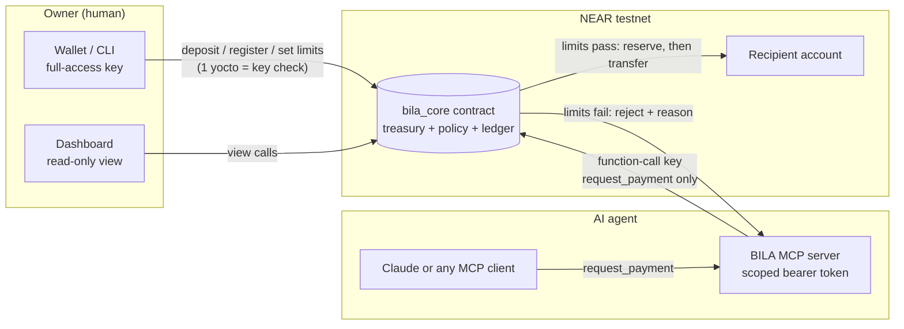

# BILA architecture

## Who can do what

| Actor | Can | Cannot |
|---|---|---|
| Owner | fund treasury, register agents, set limits, pause/revoke, withdraw unreserved funds | spend an agent's reserved funds |
| Agent (via MCP) | ask for a payment, check its own budget and history | change its limits, attach deposits, move funds directly |
| MCP server | relay agent requests with a function-call key limited to `request_payment` | loosen limits, withdraw, impersonate another agent |
| Dashboard | read | write |

## Why the contract is the enforcer

The AI model, the MCP server and any database can all be wrong or compromised. The only thing that moves money is `bila_core`, and it checks the policy on every request, on chain, before anything is sent. Limits are reserved at request time, so two payments sent at once cannot both pass a limit only one of them fits under.

## Payment flow

1. Agent calls `request_payment(request_id, recipient, amount, memo)`.
2. Contract checks: agent registered and active, per-payment cap, daily / weekly / monthly caps, treasury balance, recipient rules, duplicate `request_id`.
3. Fail: returns `rejected` with a plain reason. Nothing moves.
4. Pass: amount is reserved against every limit, transfer is sent, callback marks it `settled`. If the transfer fails, the reservation is released.
